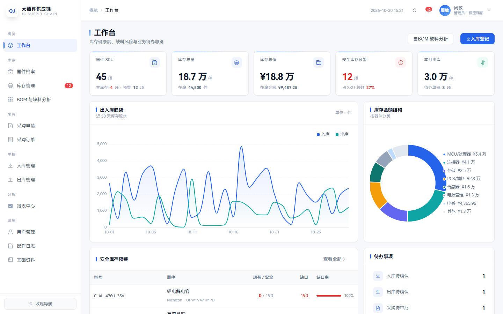
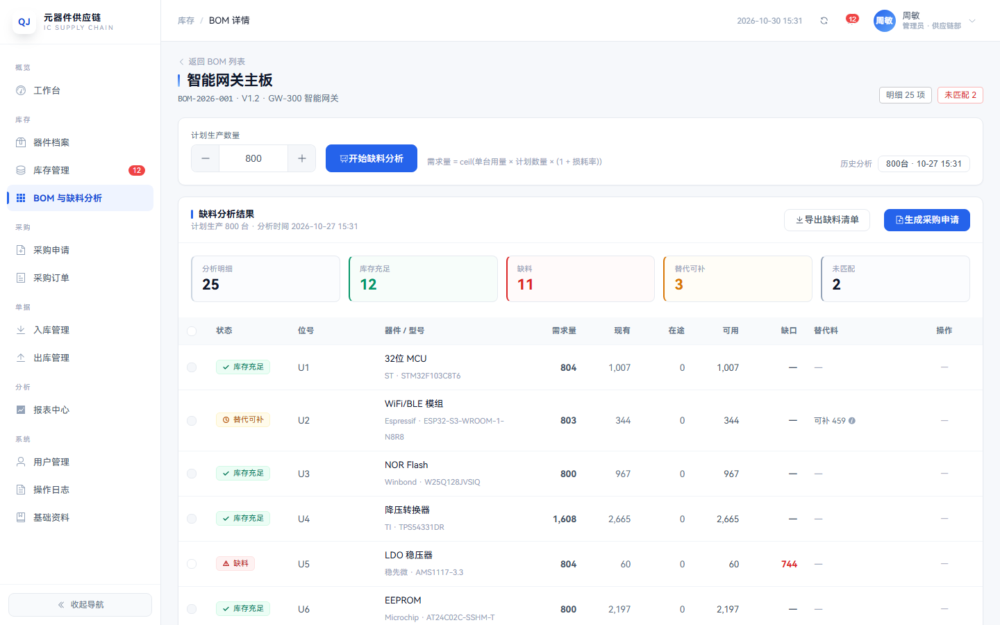
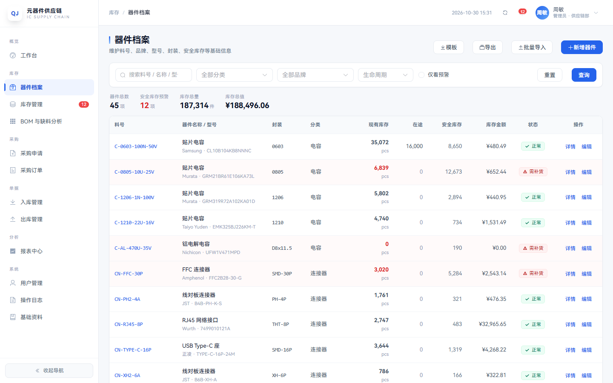
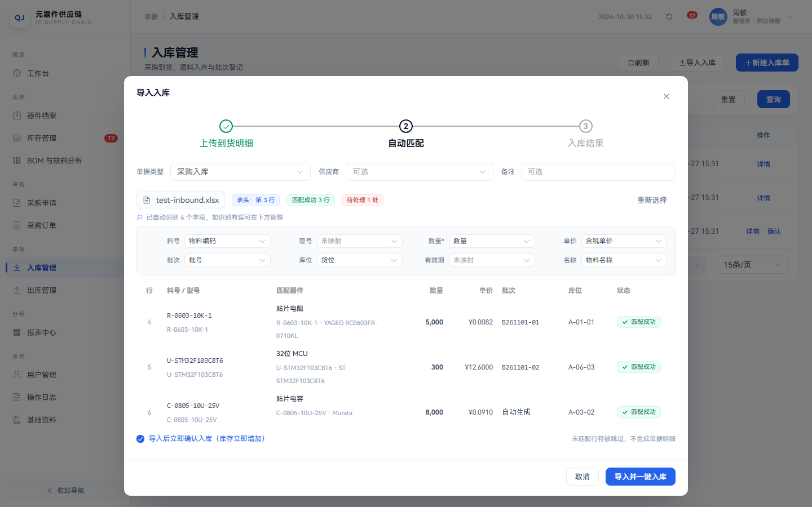
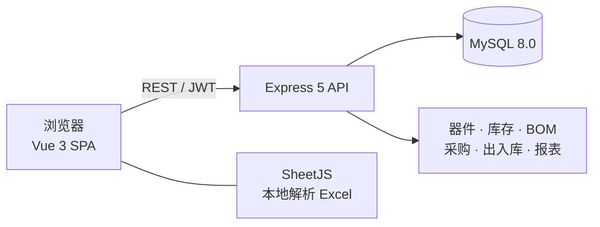

# IC Inventory · 元器件供应链管理平台

> 面向电子制造企业的 **器件档案 · 库存 · BOM 缺料分析 · 采购闭环 · 出入库** 一体化管理系统。
> 一套系统贯通「BOM 上传 → 缺料计算 → 采购申请 → 下单收货 → 入库出库 → 报表分析」的完整链路。


---

## 项目简介

电子元器件采购与仓储的痛点通常不在「记账」，而在 **BOM 与库存对不上**：一颗料停产后替代料能不能用、在途算不算可用、研发借料有没有还、SMT 抛料要不要算损耗。

本项目把这些问题收敛成一条数据链路：

- 器件档案统一料号、品牌、型号、封装、安全库存、生命周期
- BOM 上传后自动匹配器件，按计划产量计算真实缺口
- 缺料一键生成采购申请，审批后按主供应商拆单，在途自动回写
- 到货收货生成入库单，确认后库存、批次、移动加权均价同步更新
- 出库采用「提交预占 + 确认扣减」，事务行锁防止并发超发

前端为免构建 SPA，依赖全部内置于 `web/vendor`，内网服务器无需 Node 构建、无需外网即可运行。

## 界面预览

**工作台**



**BOM 缺料分析**



**器件档案**



**入库单智能导入**



---

## 功能特性

### 工作台
- 器件 SKU、库存总量、库存总值、安全库存预警、本月出库五项指标
- 近 30 天出入库趋势、库存金额分类结构
- 安全库存预警清单、业务待办、最近动态

### 器件档案
- 料号、名称、品牌、原厂型号、规格、封装、分类、安全库存、MOQ、交期、生命周期
- Excel 批量导入：预览校验、错误行标红、按料号更新或新增
- 详情抽屉：批次库存、库存流水、供应商报价、替代料
- 替代料支持「完全替代 / 有条件替代」，缺料分析时合并计算可用量

### 库存管理
- 现有 / 可用 / 预留 / 在途 / 均价 / 库存金额，低于安全库存整行高亮
- 出入库流水按类型、日期、料号筛选，正负数量分色
- 库存调整写入独立流水，可追溯
- 循环盘点：按分类生成盘点单 → 录入实盘 → 完成时自动生成差异调整流水

### BOM 与缺料分析
- **智能导入，无需固定模板**：自动定位表头行、识别中英文列名，支持无表头文件
- 识别结果可视化，9 个字段的列映射可手动调整，改完即时重新解析
- 按 **料号 → 品牌+型号 → 型号 → 名称+封装** 逐级匹配，输出精确 / 型号 / 疑似 / 未匹配统计
- 缺料结果分为：库存充足 / 缺料 / 替代可补 / 未匹配
- 未匹配行支持「一键建档」并自动回填，疑似匹配需人工确认
- 导出缺料清单、勾选缺料行一键生成采购申请

### 采购闭环
- 采购申请：草稿 → 提交 → 审批（通过 / 驳回）→ 按主供应商拆分采购订单
- 采购订单：草稿 → 下发（在途 +）→ 收货（生成入库单）→ 入库确认（在途 −、库存 +）
- 支持部分到货、订单取消回退在途

### 出入库
- 入库单：采购入库 / 生产退料 / 其他，登记批次号、库位、有效期
- 出库单：生产领料 / 借用 / 报废 / 其他
- **两步式**：录单 → 提交（预占库存）→ 确认（实际扣减），事务 + 行锁防并发超发
- **入库 Excel 智能导入**：自动识别料号、型号、数量、单价、批次、库位、有效期，按料号或型号匹配器件；未匹配行标红可跳过，可勾选「导入后立即确认入库」实现一键入库

### 报表中心
- 库存汇总：分类金额、品牌 TOP10、库存金额 TOP10、生命周期结构
- 消耗分析：30/60/90/180 天趋势、消耗 TOP12、呆滞料清单
- 采购分析：供应商采购额、月度趋势、采购金额 TOP10 器件

### 系统管理
- 三级角色：超级管理员 / 管理员 / 员工，权限矩阵集中在 `server/middleware/auth.js`
- 用户管理、密码重置、账号停用
- 操作日志：模块、动作、详情、IP、时间，可筛选
- 供应商与器件分类维护

---

## 技术栈

| 层 | 选型 |
| --- | --- |
| 前端 | Vue 3 + Element Plus + ECharts + SheetJS（全局构建，无需打包） |
| 后端 | Node.js 18+ / Express 5 / mysql2 |
| 数据库 | MySQL 8.0（InnoDB / utf8mb4） |
| 认证 | JWT + bcrypt |
| 图表 | ECharts 6 |
| Excel | SheetJS（浏览器端解析，上传前预览） |

### 架构



前后端同源部署：Express 同时提供 `/api` 接口与 `web/` 静态资源，无需 Nginx 也能单进程运行。

---

## 快速开始

### 环境要求

- Node.js >= 18
- MySQL 8.0

### 安装

```bash
git clone https://github.com/chang2005/IC-Inventory.git
cd IC-Inventory

npm install

# 配置数据库
cp .env.example .env
# 修改 .env 中的 DB_HOST / DB_USER / DB_PASSWORD / DB_NAME

# 初始化（二选一）
npm run initdb        # 空库：仅建表 + 3 个角色账号 + 12 个基础分类
npm run initdb:demo   # 演示：额外写入 45 个器件、3 套 BOM、库存与单据流水

npm start
```

访问 <http://localhost:3000>

Windows 用户可直接双击 `start.bat`。

> `npm run initdb` 与 `npm run initdb:demo` 都会 **DROP 并重建** 业务表，请确认目标库后再执行。

### 默认账号

| 角色 | 账号 | 初始密码 | 权限范围 |
| --- | --- | --- | --- |
| 超级管理员 | `superadmin` | `123456` | 全部功能 + 用户管理 + 删除权限 |
| 管理员 | `admin` | `123456` | 建档、导入、审批、确认出入库、盘点 |
| 员工 | `employee` | `123456` | 查询、BOM 分析与上传、创建申请/单据草稿 |

首次登录后请立即修改密码，并按实际人员调整账号。

### 环境变量

| 变量 | 说明 | 默认 |
| --- | --- | --- |
| `PORT` | 服务端口 | `3000` |
| `DB_HOST` / `DB_PORT` | MySQL 地址 | `localhost` / `3306` |
| `DB_USER` / `DB_PASSWORD` | MySQL 账号 | `root` / 空 |
| `DB_NAME` | 数据库名 | `qjcrk` |
| `JWT_SECRET` | JWT 签名密钥 | 必填，建议 32 位以上随机值 |
| `JWT_EXPIRES` | 登录有效期 | `12h` |

生成随机密钥：

```bash
npm run rotate-secret
```

---

## 目录结构

```
ic-inventory/
├─ server/
│  ├─ app.js                 服务入口（API + 静态站点 + SPA 兜底）
│  ├─ db.js                  mysql2 连接池
│  ├─ middleware/auth.js     JWT 鉴权 + RBAC 权限矩阵
│  ├─ utils/helpers.js       响应封装、单号生成、操作日志
│  ├─ routes/                auth / components / stock / boms
│  │                         purchases / orders / reports / system
│  ├─ sql/schema.sql         完整建表 DDL
│  └─ scripts/
│     ├─ init-db.js          初始化（默认空库，--empty / 演示模式）
│     ├─ dump-db.js          导出 SQL 备份（不依赖 mysqldump）
│     └─ rotate-secret.js    生成随机 JWT 密钥
├─ web/
│  ├─ index.html
│  ├─ assets/css/style.css   设计系统（云蓝 + 青绿，SVG 状态图标）
│  ├─ assets/js/api.js       请求封装
│  ├─ assets/js/utils.js     格式化 / Excel 智能识别 / 图表工具
│  ├─ assets/js/app.js       路由 + 布局 + 权限 + 过渡动效
│  ├─ assets/js/pages/       9 个页面组件
│  └─ vendor/                Vue / Element Plus / ECharts / SheetJS
├─ docs/screenshots/         README 截图
├─ .env.example
├─ start.bat
└─ package.json
```

---

## 核心业务规则

### 缺料计算

```
需求量 = ceil(单台用量 × 计划数量 × (1 + 损耗率 / 100))
可用量 = 现有库存 − 已预留 + 在途
缺口   = max(0, 需求量 − 可用量)
若缺口 > 0 且存在替代料：
    缺口 = max(0, 缺口 − Σ 替代料可用量)
```

### 库存一致性

- 库存变动只通过四个入口：确认入库、确认出库、库存调整、盘点完成，且全部写入 `stock_transaction`
- 出库提交时 `reserved += qty`，确认时 `quantity -= qty, reserved -= qty`
- 采购订单下发时 `in_transit += 剩余量`，入库确认时 `in_transit -= 入库量`
- 入库按 `(原库存 × 原均价 + 入库量 × 入库价) / 新库存` 更新移动加权均价
- 出入库确认使用 `SELECT ... FOR UPDATE` 行锁，避免并发超发

### 智能列识别

BOM 与入库导入共用一套识别逻辑（`web/assets/js/utils.js` 的 `smartTable`）：

1. 扫描前 15 行，按表头命中字段数量定位表头行
2. 中英文列名匹配（位号 / RefDes、型号 / MPN、数量 / Qty、品牌 / Manufacturer 等）
3. 未命中时按内容特征兜底：位号格式、型号字母数字组合、数量小整数、封装前缀
4. 无表头文件同样可以识别
5. 识别结果可在界面手动调整，实时重新解析

---

## 主要接口

| 方法 | 路径 | 说明 |
| --- | --- | --- |
| POST | `/api/auth/login` | 登录获取 JWT |
| GET | `/api/components` | 器件分页搜索（含实时库存） |
| POST | `/api/components/import` | 器件 Excel 批量导入 |
| POST | `/api/components/match` | 按料号 / 型号批量匹配器件 |
| GET | `/api/stock` | 库存查询 / 预警 |
| GET | `/api/stock/transactions` | 出入库流水 |
| POST | `/api/boms/import` | BOM 导入并自动匹配 |
| POST | `/api/boms/:id/analyze` | 缺料分析 |
| POST | `/api/bom-analyses/:id/to-purchase-request` | 缺料生成采购申请 |
| POST | `/api/purchase/requests/:id/to-orders` | 按供应商拆分订单 |
| POST | `/api/purchase/orders/:id/send` | 下发（在途 +） |
| POST | `/api/inbound-orders/:id/confirm` | 确认入库（事务） |
| POST | `/api/inbound-orders/import` | Excel 导入入库（可一键确认） |
| POST | `/api/outbound-orders/:id/submit` | 提交出库（预占） |
| POST | `/api/outbound-orders/:id/confirm` | 确认出库（事务） |
| GET | `/api/reports/dashboard` | 工作台统计 |

完整接口见 `server/routes/`。

---

## 部署

```bash
npm install --omit=dev      # 仅安装后端运行依赖
npm run initdb              # 空库初始化
npm i -g pm2
pm2 start server/app.js --name ic-inventory
pm2 save && pm2 startup
```

Nginx 反向代理：

```nginx
server {
    listen 80;
    server_name your-domain.com;
    client_max_body_size 20m;

    location / {
        proxy_pass http://127.0.0.1:3000;
        proxy_set_header Host $host;
        proxy_set_header X-Real-IP $remote_addr;
        proxy_set_header X-Forwarded-For $proxy_add_x_forwarded_for;
    }
}
```

上线检查：

- 修改 `.env` 中的数据库密码与 `JWT_SECRET`
- 首次登录后立即修改初始密码
- 建议开启 HTTPS 与 MySQL 每日备份

### 数据库备份

```bash
npm run backup
# 输出：backup/qjcrk_YYYYMMDD_HHmm.sql
```

导入备份：

```bash
mysql -u root -p qjcrk < backup/qjcrk_20261030_1533.sql
```

---

## Roadmap

- [ ] 条码 / 二维码标签打印与扫码出入库
- [ ] 多仓库与库位调拨
- [ ] 审批流可配置（多级审批）
- [ ] 消息通知（企业微信 / 邮件）
- [ ] Docker Compose 一键部署
- [ ] 单元测试与 E2E 测试

---

## License

[MIT](LICENSE)
